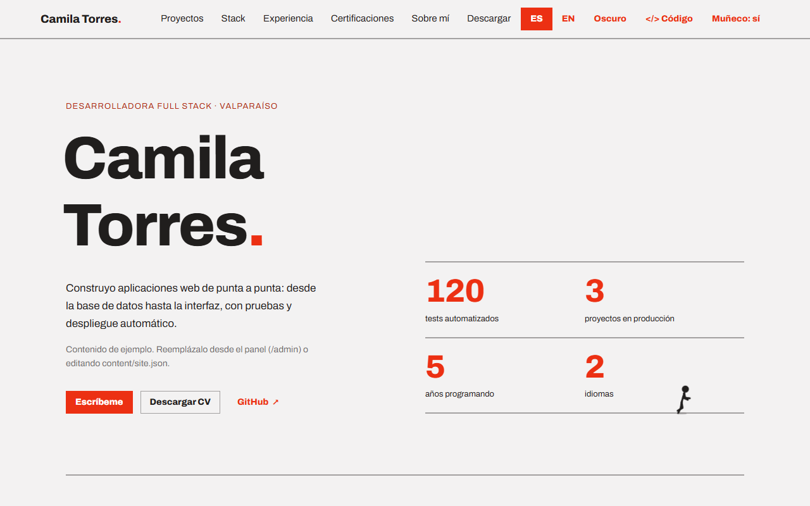
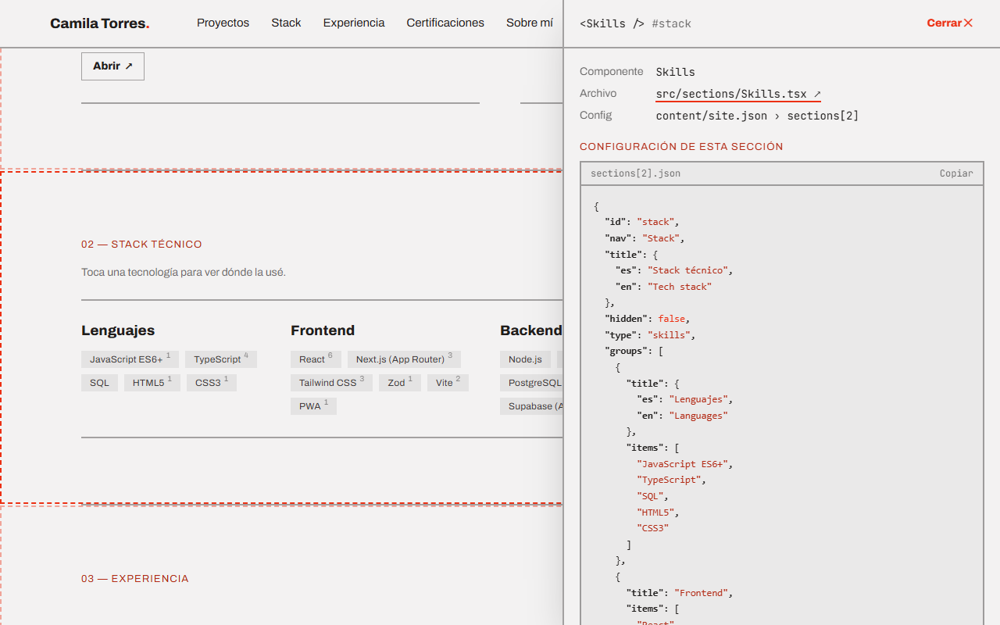
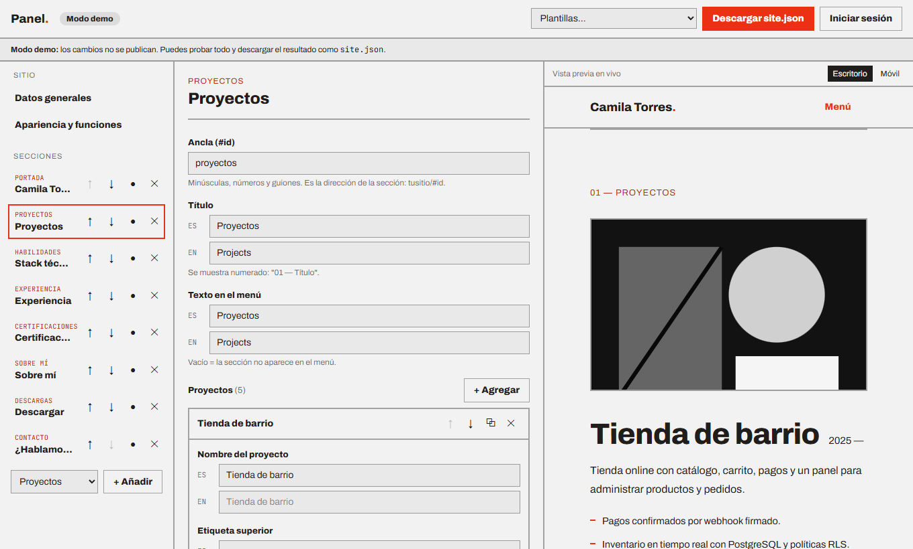

# portafolio

**Un portafolio que es también su propio proyecto.** Plantilla de código abierto para crear un portafolio
profesional editando **un solo archivo**, o desde un **panel administrativo** que publica con tu cuenta de GitHub.
Sirve para cualquier área: desarrollo, diseño, gastronomía, docencia…



## Qué incluye

| | |
|---|---|
| **Un archivo, todo el contenido** | `content/site.json` define textos, proyectos, tema y orden de secciones. No hay que tocar componentes. |
| **Panel `/admin`** | Inicias sesión con un token de GitHub, editas con formularios (con vista previa en vivo, subida de imágenes e historial) y publicas con un clic: cada cambio es un commit y el sitio se despliega solo. |
| **Modular** | El portafolio es una lista de secciones (`hero`, `projects`, `skills`, `timeline`, `credentials`, `about`, `gallery`, `text`, `download`, `contact`). Reordenar es mover un bloque; ocultar es `hidden: true`. |
| **Validado** | Un esquema de [Zod](https://zod.dev) revisa el contenido, en el build y en el panel, con mensajes en español: `sections[2] (proyectos) › items[0] › title`. |
| **Descargable** | Sección de descargas: tu CV, el código del repo en .zip, "Usar como plantilla" y "Guardar esta página como PDF". |
| **Inspector `</> Código`** | Quien visita el sitio ve qué componente, qué archivo y qué configuración producen cada sección, con enlace al código en GitHub. |
| **Filtro por tecnología** | Toca "React" y se resaltan los proyectos y trabajos donde se usó. |
| **Bilingüe y con temas** | Cualquier texto puede ser `"Hola"` o `{ "es": "Hola", "en": "Hi" }`. 3 estilos, color de acento, tipografía y modo claro/oscuro. |
| **Muñeco animado** | Un personaje en SVG que corre y salta sobre los bordes de la página y "presiona" lo que clickeas. Se puede apagar. |



## Empezar en 5 minutos

1. **Haz fork** (o "Use this template") y activa **Settings › Pages › Source: GitHub Actions**.
2. Abre `https://<tu-usuario>.github.io/<repo>/admin/` y prueba el **modo demo** (no publica nada).
3. Crea un token en GitHub: *Settings › Developer settings › Fine-grained tokens* → **Only select repositories** → tu repo,
   permisos **Contents: Read and write** y **Actions: Read**. Pégalo en el panel y edita.
4. Pulsa **Publicar**. En 1–2 minutos el sitio muestra los cambios.

También puedes trabajar en local:

```bash
npm install
npm run dev        # http://localhost:3000  y  /admin
npm run validate   # revisa content/site.json
```



## Contenido privado: que el repo no exponga datos personales

Si publicas el código abierto pero no quieres que tu nombre, teléfono, CV o certificados estén en el repo,
guarda el contenido en **otro repositorio privado**. El repo público solo lleva el motor y la plantilla de ejemplo;
cuando GitHub Actions despliega, junta ambos y el sitio muestra tus datos. El panel edita el repo privado y lanza el despliegue.

```
repo público  (portafolio)            repo privado  (portafolio-contenido)
├─ src/, tests/, .github/…            ├─ content/site.json     ← tus datos
├─ content/site.json  ← plantilla     └─ public/               ← CV, imágenes, certificados
└─ public/examples/                      (y public/uploads/ con lo que subas desde el panel)
```

**Configuración (una vez):**

1. Crea el repo privado con esa estructura (`content/site.json` y `public/`).
2. Genera una *deploy key* de solo lectura:
   `ssh-keygen -t ed25519 -N "" -C deploy -f clave`
   - En el repo **privado**: *Settings › Deploy keys › Add deploy key*, pega `clave.pub` (sin permiso de escritura).
   - En el repo **público**: *Settings › Secrets and variables › Actions*, secreto `CONTENT_DEPLOY_KEY` con el contenido de `clave`.
   - Borra los archivos `clave` y `clave.pub` de tu equipo.
3. En el repo público crea la **variable** `CONTENT_REPOSITORY` con `<tu-usuario>/<repo-privado>`.
4. Haz push (o ejecuta el workflow *Deploy*). El panel detecta solo que el contenido está en otro repo.

El token del panel debe dar acceso a **los dos repos** con **Contents: Read and write** y **Actions: Read and write**
(para lanzar el despliegue).

**En local**, apunta `CONTENT_DIR` a una copia de tu repo privado (por ejemplo en `.env.local`, que git ignora):

```bash
echo 'CONTENT_DIR=../portafolio-contenido' >> .env.local
npm run content:sync     # copia tus imágenes a public/ sin que git las vea
npm run dev
```

## Estructura

```
content/
  site.json            ← tu contenido (lo único que necesitas editar)
  schema.json          ← autocompletado en VS Code (npm run schema)
  examples/            ← perfiles de ejemplo: desarrolladora, chef, diseñadora
src/
  core/                ← esquema (Zod), tema, i18n, repos
  sections/            ← un componente por tipo de sección + registry.ts
  components/          ← navegación, inspector, visor de certificados, muñeco
  admin/               ← panel: formularios, cliente de GitHub, subidas, borrador
  app/                 ← páginas: / y /admin
tests/                 ← Vitest + Testing Library
e2e/                   ← Playwright
```

## Tipos de sección

Todas aceptan `id` (ancla), `title` ("01 — Título"), `nav` (texto en el menú) y `hidden`.

| `type` | Para qué | Campos principales |
|---|---|---|
| `hero` | Portada | `headline`, `eyebrow`, `intro`, `meta`, `actions`, `aside` (`stats` o `image`) |
| `projects` | Proyectos o casos | `items[]`: `title`, `description`, `highlights`, `stats`, `tags`, `links`, `media` (`image` o `code`), `featured` |
| `skills` | Habilidades agrupadas | `groups[]`: `title`, `items` |
| `timeline` | Experiencia | `items[]`: `period`, `title`, `subtitle`, `description`, `tags` |
| `credentials` | Estudios y certificados | `highlights[]`, `listTitle`, `items[]` (`title`, `value`, `date`, `href`: imagen o enlace) |
| `about` | Sobre mí | `statement`, `facts[]` |
| `gallery` | Imágenes | `items[]`: `src`, `alt`, `caption` |
| `text` | Párrafos libres | `body` |
| `download` | Descargas | `items[]`: `kind` (`zip`, `template`, `file`, `link`, `print`), `label`, `description`, `href` |
| `contact` | Cierre de contacto | `headline`, `lines[]` |

## Crear un tipo de sección nuevo

1. **Esquema:** en `src/core/schema.ts`, crea la sección y agrégala a `SectionSchema`.
2. **Componente:** `src/sections/MiTipo.tsx`, que recibe `{ section }` ya tipado.
3. **Registro:** agrégalo a `src/sections/registry.ts` (TypeScript avisa si falta).
4. **Plantilla y formulario:** un bloque inicial en `src/core/templates.ts` y sus campos en `src/admin/spec.ts`.

## Scripts

| Comando | Qué hace |
|---|---|
| `npm run dev` | Servidor de desarrollo |
| `npm run validate` | Valida `content/site.json` y los ejemplos (incluye traducciones faltantes) |
| `npm test` | Tests unitarios y de componentes (Vitest) |
| `npm run e2e` | Tests en navegador (Playwright; requiere `npm run build`). Con `PW_CHANNEL=msedge` usa tu navegador instalado |
| `npm run check` | Tipos + lint + tests + build, igual que la CI |
| `npm run schema` | Regenera `content/schema.json` |
| `npm run content:sync` | Copia las imágenes de `CONTENT_DIR` a `public/` (ver "Contenido privado") |

## Seguridad del panel

- El token vive en tu navegador (sessionStorage; localStorage solo si marcas "Recordar") y solo se envía a `api.github.com`.
  La página `/admin` declara una política de seguridad (CSP) que bloquea cualquier otra conexión.
- Usa un token **fine-grained** limitado a tus repos y con vencimiento. Si alguien sin permiso de escritura entra al panel, no puede publicar.
- Los enlaces del contenido no admiten `javascript:` ni `data:`.

## Stack

Next.js 15 (App Router, export estático) · React 19 · TypeScript · Tailwind CSS 4 · Zod 4 · Vitest · Testing Library · Playwright · GitHub Actions.
Sin dependencias de UI ni de animación: el muñeco y el resaltado de código están escritos a mano.

## Contribuir y licencia

Ideas de secciones, temas y traducciones son bienvenidas: lee [CONTRIBUTING.md](CONTRIBUTING.md). Licencia [MIT](LICENSE).

---

### English

**portafolio** is an open-source portfolio template. All content lives in one typed, Zod-validated file (`content/site.json`) and can be edited
from an admin panel (`/admin`) that signs in with a GitHub token and publishes each change as a commit. Sections are swappable modules,
visitors can toggle **`</> Code`** to see which component renders each part, and the site offers downloads (CV, source zip, template, print to PDF).
To keep personal data out of a public repo, store the content in a **private repo** and set `CONTENT_REPOSITORY` + a read-only deploy key:
GitHub Actions merges both at build time and the panel edits the private repo.
